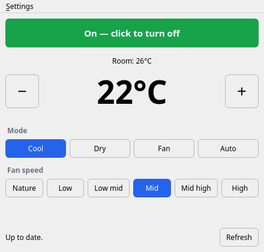

# LG AC Desktop

A small desktop app for controlling an LG ThinQ air conditioner from your PC: power, mode, target temperature and fan speed.



It talks to LG's official [ThinQ Connect API](https://smartsolution.developer.lge.com/en/apiManage/thinq_connect) through LG's [`thinqconnect`](https://github.com/thinq-connect/pythinqconnect) Python SDK. It doesn't reverse-engineer the ThinQ app or use your LG password. Instead it uses a Personal Access Token that you create and can revoke at any time.

Built and tested against a wall-mounted unit (model S3NQ09AM31A), but it reads each unit's own capability profile. Modes, fan speeds and temperature limits therefore match whatever your model supports.

## Setup

You need Python 3.11+ and an air conditioner already added to the LG ThinQ phone app.

```bash
git clone https://github.com/gabrielcs-aero/lg-ac-desktop.git
cd lg-ac-desktop
python3 -m venv .venv
.venv/bin/pip install -e .
```

### Get a token

1. Open <https://connect-pat.lgthinq.com> and sign in with the LG account you use in the ThinQ app.
2. Create a Personal Access Token. Give it permission to list devices, read device status, and control devices.
3. Copy the token. The app asks for it the first time it starts.

## Run

```bash
.venv/bin/lg-ac
```

On the first run, paste the token and your two-letter country code (e.g. `BR`). To change them later, use **Settings → Change token…**.

To try the app without a token or an air conditioner, run it against a simulated unit:

```bash
.venv/bin/lg-ac --demo
```

## How it works

- `lg_ac/controller.py` lists your air conditioners, loads the unit's profile and status, and sends commands. Each command is validated against the profile before it's sent, so the app never sends a value your unit doesn't support.
- `lg_ac/app.py` is the PySide6 (Qt) window. Changes show up instantly and are sent in the background, one at a time and in order. A few seconds after your last change, the window reads the unit back to confirm, and it undoes anything LG rejected. Clicking **+**/**−** several times in a row sends a single temperature command once you stop clicking. Status refreshes every 60 seconds and whenever you press **Refresh**.
- Settings are stored in `~/.config/lg-ac-desktop/config.json`, readable only by your user (permissions `600`). The token never goes anywhere except LG's API.

## Tests

```bash
.venv/bin/python -m unittest discover -s tests -t .
```

The tests run against the simulated unit in `lg_ac/demo.py`, so they don't need a token.

## Troubleshooting

| Message | What to do |
| --- | --- |
| "check your token" | The token is wrong, expired or revoked. Create a new one and enter it via **Settings**. |
| "the air conditioner is offline" | The unit lost Wi-Fi. Check that it shows as online in the ThinQ app. |
| "turn on remote control" | Enable remote control for the unit in the ThinQ app. |
| "No air conditioner found" | Make sure the unit is registered to the same LG account the token belongs to, and that the country code matches. |

Not affiliated with or endorsed by LG Electronics.
