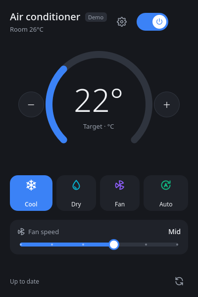

# LG AC Desktop: control your LG ThinQ air conditioner from Linux

[](https://github.com/gabrielcs-aero/lg-ac-desktop/actions/workflows/tests.yml)

Control an **LG ThinQ air conditioner** (split / wall-mounted AC) from your **Linux** PC, without your phone. It comes as a desktop app, a **KDE Plasma widget** and a **GNOME Shell extension**, and uses LG's official ThinQ Connect API.



## Features

- Power, mode (cool, dry, fan, auto, and heat on models that have it), target temperature and fan speed
- Swing, power save and the unit's display light
- On/off and sleep timers
- One-click presets: **Sleep**, **Max cool**, **Eco**
- Live updates: changes made with the remote or the ThinQ app show up within seconds
- Panel widgets for KDE Plasma 6 and GNOME 45–49, plus a command-line tool
- Light and dark themes; adapts to whatever your model supports

Tested with an LG wall-mounted unit (model S3NQ09AM31A), but it should work with any air conditioner in the ThinQ app.

## Install

**Arch Linux / Manjaro**

```bash
git clone https://github.com/gabrielcs-aero/lg-ac-desktop.git
cd lg-ac-desktop/packaging/aur/lg-ac-desktop-git
makepkg -si
```

This installs the app, the command-line tool, and both panel widgets.

**Other distributions** (Python 3.11+)

```bash
git clone https://github.com/gabrielcs-aero/lg-ac-desktop.git
cd lg-ac-desktop
python3 -m venv .venv && .venv/bin/pip install -e .
scripts/install-desktop-entry.sh    # adds "LG AC Desktop" to your app launcher
```

## Setup

1. Make sure your air conditioner is added to the **LG ThinQ** phone app.
2. Go to <https://connect-pat.lgthinq.com>, sign in with the same LG account and create a **Personal Access Token**. Allow it to list devices, read their status and control them.
3. Open **LG AC Desktop** and paste the token.

You can revoke the token at any time. It's stored only on your computer (`~/.config/lg-ac-desktop/`).

Want to look around first? `lg-ac --demo` runs the app against a simulated air conditioner.

## Panel widgets

**KDE Plasma:** run `scripts/install-kde-widget.sh` (not needed with the Arch package). Then right-click the panel → **Add or Manage Widgets** → **LG Air Conditioner**.

**GNOME:** run `scripts/install-gnome-extension.sh`, log out and back in, then `gnome-extensions enable lg-ac@gabrielcs-aero.github.io`. *The GNOME extension is new and hasn't been tested on a real GNOME desktop yet; please report any issues.*

Set up the app first; the widgets use its token.

## Command line

```bash
lg-ac-cli status              # current state as JSON
lg-ac-cli temp 23 --mode COOL
lg-ac-cli timer stop 90       # turn off in 90 minutes
lg-ac-cli preset sleep
lg-ac-cli --help              # all commands
```

(Use `.venv/bin/lg-ac-cli` if you installed with pip.)

## Troubleshooting

| Problem | Fix |
| --- | --- |
| "check your token" | The token is wrong or revoked. Create a new one and enter it via the gear button. |
| "No air conditioner found" | The AC must be on the same LG account as the token, and the country code must match. |
| "the air conditioner is offline" | The unit lost Wi-Fi. Check it in the ThinQ app. |
| "turn on remote control" | Enable remote control for the unit in the ThinQ app. |

Not affiliated with or endorsed by LG Electronics. MIT licensed.
