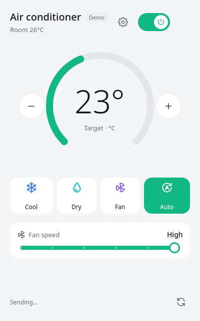
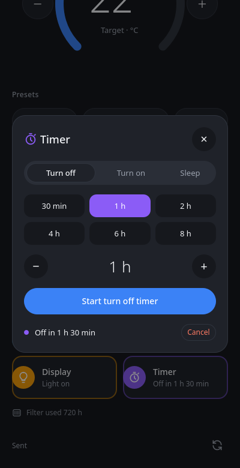
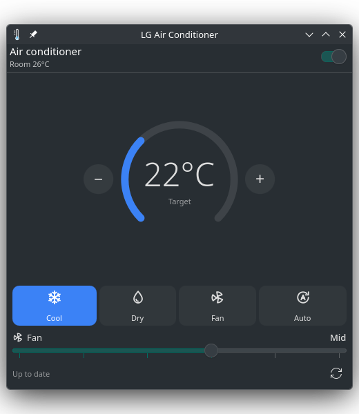

# LG AC Desktop

[](https://github.com/gabrielcs-aero/lg-ac-desktop/actions/workflows/tests.yml)

Control an LG ThinQ air conditioner from your Linux desktop: power, mode, temperature and fan speed, plus swing, power save, the display light, on/off and sleep timers, filter hours and one-click presets. It comes in three forms:

- **Desktop app**: a window you open from your app launcher.
- **KDE Plasma widget**: sits in your panel, shows the current temperature, and opens the controls with a click.
- **GNOME Shell extension**: the same idea for the GNOME top bar.

| App | More controls | Timer | KDE Plasma widget |
| --- | --- | --- | --- |
|  |  |  |  |

It talks to LG's official [ThinQ Connect API](https://smartsolution.developer.lge.com/en/apiManage/thinq_connect) through LG's [`thinqconnect`](https://github.com/thinq-connect/pythinqconnect) Python SDK. It uses a Personal Access Token that you create and can revoke at any time.

Built and tested against a wall-mounted unit (model S3NQ09AM31A), but it reads each unit's own capability profile. Modes, fan speeds and temperature limits therefore match whatever your model supports.

**Presets:** *Sleep* (25°, quiet fan, display off, off after 8 h), *Max cool* (coldest setting, full fan, swing) and *Eco* (26°, low fan, power save). A preset only changes what your unit supports, and it lights up when the unit already matches it.

**Live updates:** changes made with the remote or the ThinQ phone app show up within seconds, through LG's push service (a green **Live** marker appears when it's connected). If push isn't available, everything falls back to checking every minute.

Changes show up instantly and are sent in the background, one at a time and in order. A few seconds after your last change the unit is read back to confirm, and anything LG rejected is undone.

## Install

You need Python 3.11+ and an air conditioner already added to the LG ThinQ phone app.

```bash
git clone https://github.com/gabrielcs-aero/lg-ac-desktop.git
cd lg-ac-desktop
python3 -m venv .venv
.venv/bin/pip install -e .
scripts/install-desktop-entry.sh   # optional: adds "LG AC Desktop" to your app launcher
```

### Get a token

1. Open <https://connect-pat.lgthinq.com> and sign in with the LG account you use in the ThinQ app.
2. Create a Personal Access Token. Give it permission to list devices, read device status, and control devices.
3. Start the app (`.venv/bin/lg-ac`) and paste the token when it asks. To change it later, use the gear button.

Settings are stored in `~/.config/lg-ac-desktop/config.json`, readable only by your user (permissions `600`). The panel widgets use the same settings, so set up the app first.

To try the app without a token or an air conditioner, run it against a simulated unit: `.venv/bin/lg-ac --demo`.

## KDE Plasma widget (Plasma 6)

```bash
scripts/install-kde-widget.sh
```

Then right-click your panel → **Add or Manage Widgets** → search for **LG Air Conditioner** and drag it onto the panel. The panel shows the mode icon and target temperature; click it for the controls. Run the script again after updating, then restart Plasma with `systemctl --user restart plasma-plasmashell`.

## GNOME Shell extension (GNOME 45–49)

```bash
scripts/install-gnome-extension.sh
```

Log out and back in, then enable it with `gnome-extensions enable lg-ac@gabrielcs-aero.github.io`. It adds the mode icon and temperature to the top bar, with the controls in its menu.

> The extension's backend is tested (see below), but the top-bar UI hasn't been tried on a real GNOME session yet. If something looks off, please open an issue.

Both install scripts accept `--demo` to point the widget at the simulated unit instead.

## Command line

The widgets use `lg-ac-cli`, which you can also call yourself. Each command prints one line of JSON.

```bash
.venv/bin/lg-ac-cli status
.venv/bin/lg-ac-cli power on
.venv/bin/lg-ac-cli mode COOL
.venv/bin/lg-ac-cli temp 23.5 --mode COOL
.venv/bin/lg-ac-cli fan HIGH
.venv/bin/lg-ac-cli swing on
.venv/bin/lg-ac-cli power-save off
.venv/bin/lg-ac-cli display off
.venv/bin/lg-ac-cli timer stop 90     # turn off in 90 minutes (start / stop / sleep; 0 cancels)
.venv/bin/lg-ac-cli preset sleep      # sleep / max_cool / eco
.venv/bin/lg-ac-cli watch             # wait for a change pushed by LG (used by the widgets)
```

It caches your unit's profile in `~/.cache/lg-ac-desktop/` so each call needs only one request to LG. The certificates for live updates are kept there too, readable only by you.


## Troubleshooting

| Message | What to do |
| --- | --- |
| "check your token" | The token is wrong, expired or revoked. Create a new one and enter it via the gear button. |
| "the air conditioner is offline" | The unit lost Wi-Fi. Check that it shows as online in the ThinQ app. |
| "turn on remote control" | Enable remote control for the unit in the ThinQ app. |
| "No air conditioner found" | Make sure the unit is registered to the same LG account the token belongs to, and that the country code matches. |
| Widget says "Not set up yet" | Open the desktop app once and enter your token. |

Not affiliated with or endorsed by LG Electronics.
